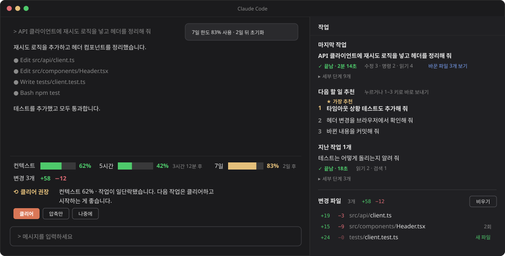

# session-hud

Claude Code 세션의 **사용량·작업 진행·변경 파일**을 한눈에 보여 주는 모드입니다.



화면 구성은 터미널·데스크톱 앱·테마에 따라 다릅니다.

## 설치

**터미널**

```bash
claude plugin install session-hud --marketplace scalper86/session-hud
```

- `Add marketplace?` → `y`, 설치 범위 → `user`
- 세션 안에서 설치: `/plugin install session-hud --marketplace scalper86/session-hud`

**데스크톱 앱**

입력창 옆 `+` → **Plugins** → **Add marketplace** → `scalper86/session-hud` 입력 → **Add plugin**

새 세션부터 적용됩니다.

## 주요 기능

| 기능 | 내용 |
| --- | --- |
| 사용량 표시 | 입력창 위에 컨텍스트 사용률과 5시간·7일 한도를 막대와 %로 표시. 값을 받기 전에는 `–`로 표시 |
| 사용량 색상 | 80% 미만 초록 / 80% 이상 노랑 / 90% 이상 빨강 |
| 사용량 갱신 | 1분마다 남은 시간 갱신. 초기화 시각이 지난 한도는 0%로, 압축 직후 컨텍스트는 바로 반영 |
| 작업 추적 | 요청별 번호, 요약, 상태, 소요 시간, 수정·명령·읽기 단계 수 표시 |
| 작업 상태 | ● 진행 중 / ✓ 끝남 / ■ 중단됨 |
| 단계 확인 | 세부 단계 펼치기, 실행 중인 단계는 접힌 상태에서도 표시 |
| 작업 기록 | 최근 3개 표시, 나머지는 펼쳐 보기 |
| 파일 추적 | 이번 세션의 변경 파일과 추가·삭제 줄 수 표시, 작업별 필터 제공 |
| 다음 할 일 추천 | 작업 완료 후 Haiku가 후속 작업 3개를 순위대로 추천. 클릭 또는 `1`–`3` 입력 시 메시지 전송 |
| Diff 확인 | 변경 줄 비교 및 전체 파일 보기 |
| 컨텍스트 관리 | 사용량과 작업 상태에 따라 압축·클리어 권장 |
| 완료 알림 | 기본 30초 이상 걸린 작업 완료 시 시스템 알림 |
| 한도 경고 | 사용 한도가 80%·90%를 넘으면 알림 |
| 예산 경고 | 설정한 세션 예산의 80%·100%에 도달하면 알림 |

### 작업 패널

세션이 시작되면 열리고, 항목은 늘 그대로 두고 내용만 바뀝니다. 비어 있는 항목은 `지난 작업이 없습니다.`처럼 표시합니다.

- `작업 N개 · 변경 N개` 클릭 → 대화 옆 작업 패널 열기
- `▸ 세부 단계 N개` 클릭 → 단계 펼치기
- 파일을 바꾼 작업은 작업명 색상이 달라지고 `파일 2개 +22 −3`처럼 표시됩니다.
- 작업명 클릭 → 해당 작업의 변경 파일만 표시. 다시 클릭하거나 `전체 보기`로 해제합니다.
- `▸ 이전 작업 N개 더 보기` 클릭 → 최근 3개보다 이전 작업 표시
- 변경 파일 클릭 → Diff 화면

> Bash 명령(`git`, `sed` 등)으로 변경한 파일은 목록에 표시되지 않습니다.

### Diff 단축키

기본적으로 변경 줄만 표시하고, 나머지는 `⋯ 40행 근처`처럼 접습니다.

| 키 | 기능 |
| --- | --- |
| `f` | 전체 파일 표시 (추가 줄은 초록, 삭제 줄은 빨강) |
| `c` | 변경 줄만 표시 |
| `b` | 목록으로 돌아가기 |

### 컨텍스트 관리

권장 버튼은 클릭할 때만 실행됩니다.

- **압축**: 기준(기본 80%) 초과 시 권장, 90% 이상이면 빨간색 강조
- **클리어**: 작업이 일단락되고 사용률이 50% 이상이거나, 2회 이상 압축한 뒤 다시 기준을 초과하면 권장. 실행 전 재확인
- **나중에**: 사용률이 10%p 더 오를 때까지 권장 숨김

## 명령어

- `/session-hud` — 토큰 수, 한도 초기화 시각, 비용, 변경 파일 합계 상세 확인
- `/config` — 설정 변경

## 설정

설치할 때 또는 세션의 `/config`에서 변경합니다.

| 항목 | 기본값 | 설정 내용 |
| --- | --- | --- |
| 세션 예산 (USD) | 0 (끔) | API 요금 환산 비용이 예산의 80%·100%에 도달하면 경고 |
| 압축 권장 기준 (%) | 80 | 기준 초과 시 압축·클리어 권장, 0이면 비활성화 |
| 완료 알림 기준 (초) | 30 | 기준보다 오래 걸린 작업 완료 시 알림, 0이면 비활성화 |
| 작업 패널 자동 열기 | 켬 | 세션 시작 시 패널 열기 |
| 다음 할 일 추천 | 켬 | 끄면 Haiku 호출 비용이 들지 않고 클리어 권장은 압축 횟수로만 판단 |

## 업데이트

**수동 업데이트**

```bash
claude plugin update session-hud@scalper86-mods
```

**자동 업데이트**

세션에서 `/plugin` → **Marketplaces** → `scalper86-mods` → **Enable auto-update**를 켭니다.

**SSH 키가 없어 업데이트가 실패할 때**

```bash
export CLAUDE_CODE_PLUGIN_PREFER_HTTPS=1
```

환경 변수를 설정한 뒤 다시 시도합니다. 업데이트는 새 세션부터 적용됩니다.
